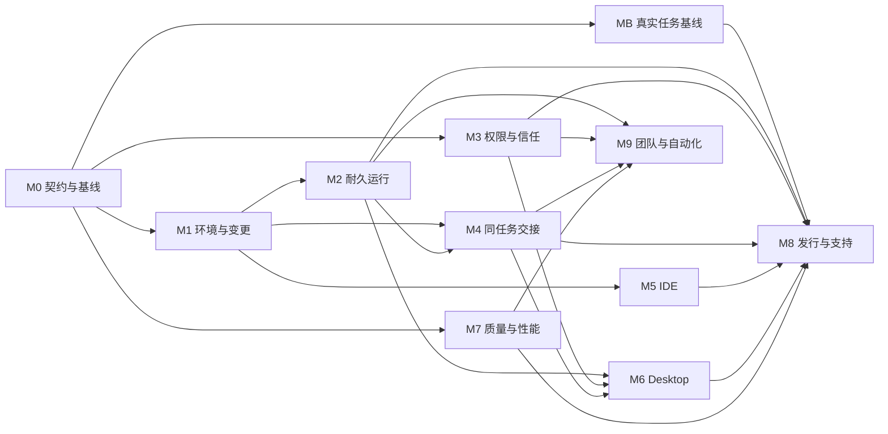

# AgentZ 产品优化升级路线图

计划版本：7（2026-10-13 全量复评及首批修复）；制定日期：2026-10-04；实施基线：a787b6d / AgentZ 0.9.6。

实施已经启动。当前状态见[进度板](progress.md)，当前源码和台账的逐项对照、构建检查与新的执行顺序见[2026-10-13 全量复评](reassessment-2026-10-13.md)。[版本3进展](evidence/revision-3-progress.md)保留为历史记录。持续推进的 heartbeat（automation id: `agentz`）仅在实质进展或需决策时通知；此授权不包含对外发布。

执行变更：[ADR-002](evidence/ADR-002-baseline-gate.md)将真实模型效果基准AZ-004单列为MB Gate，工程契约M0先解锁确定性修复；MB仍是稳定版发行前置。[ADR-003](evidence/ADR-003-scope-horizon.md)按已经落地的宿主代码收束当前视野，并把AZ-028未完成的工具表面拆成独立任务。当前为83项任务、11个Gate。

## 从哪里开始

- [审查依据](../agentz-product-maturity-review-2026-10-04.md)：12 组发现与证据。
- [当前全量复评与执行计划](reassessment-2026-10-13.md)：83 项当前状态、构建风险与分批验收顺序。
- [原子任务清单](tasks.md)：83 项任务的完整范围、依赖、验收与回退。
- [机器可读台账](plan.json)：任务、里程碑与审计历史的唯一状态源。
- [周期与发布复盘模板](review-template.md)：迭代、任务、事故和发布的记录格式。
- `node scripts/upgrade-plan.mjs ready`：列出可以进入下一步的任务。

tasks.md 由 JSON 生成，请不要手工改它的状态。历史 docs/tasks.md 保留旧任务；这份计划的实施状态集中在这里，避免双重维护。

## 产品目标与范围

AgentZ 面向开发者，提供人与 Agent 共用工作环境的桌面工作台。CodeZ 负责直接编辑、调试和接手，WorkZ 负责目标委派、长期执行、阻塞处理与交付评审。

首批必须打通三条旅程：

1. 真实工程 bug 修复：隔离执行 → 人接手 → Agent 继续 → 完整评审 → 应用/PR → 归档恢复。
2. 代码研究：带来源的分析 → 可打开报告 → 人补充约束 → 修订 → 验收。
3. 非代码文档：无仓库任务目录 → 文档生成/预览 → 人编辑 → Agent 继续 → 产物归档。

首个稳定版包括经过验证的核心 IDE、长期任务运行、产物交付、受控连接器与 Windows Desktop 最小能力。macOS/Linux 各项能力只按真实验证结果声明支持；原生桌面控制未验收时保持明确的未支持状态。首期文档产物为 Markdown/HTML，复杂 Office/设计资产按后续模板和连接器能力扩展，不冒充已交付。

本期保留 Tauri/React/Rust/Node 与共享内核，通过局部职责拆分改善可靠性。任意应用全自动操作、任意 VSIX 完整兼容、企业多租户/计费、移动客户端与云托管不属于首期承诺；在首期闭环稳定后重新立项。

## 里程碑路线

每个里程碑都有一个需要负责人和证据签署的 Gate。任务代码合入并不自动通过产品 Gate。

| 里程碑 | 用户得到什么 | 关键交付 | 退出验收 |
| --- | --- | --- | --- |
| M0 产品契约与基线 | 清楚产品支持什么 | 用户旅程、身份契约、风险复现、任务与性能基线、容量 | 目标与证据固定，负责人和首次周期确定 |
| MB 真实任务效果基线 | 了解实测质量与成本 | 固定模型/任务结果、干预和性能 | 实际基准有证据，缺失项不冒充通过 |
| M1 环境与可信变更 | 工作不串环境，评审看到真实改动 | 持久环境绑定、完整ChangeSet、journal路由、归档恢复、合并预检 | A/B切换、重启、未提交评审与恢复案例通过 |
| M2 耐久运行 | 停止与中断可解释且可续跑 | Run/Attempt、事件游标、恢复对账、计划、预算、幂等 | 队列取消、重启、断网和副作用丢结果案例通过 |
| M3 权限与信任 | 明确授权，秘密与扩展受控 | 审批意图、系统凭据、脱敏、Webview、受限策略 | 权限越界与秘密保存失败的反例通过 |
| M4 同任务交接 | 人与Agent可以连续协作 | 统一任务DTO、CodeZ环境、人工接手、产物版本、验收UI | 三条核心旅程端到端完成 |
| M5 IDE日常体验 | 可以持续在真实工程里工作 | 脏缓冲、LSP、DAP、PTY、SSH、扩展兼容、交互 | 声明支持的工程和扩展有实测记录 |
| M6 Desktop工作 | 研究、文档、外部应用也能交付 | 无仓库目录、报告、连接器、发送、浏览器与前台租约 | 外部动作有授权/对账，抢占可停止 |
| M7 质量与性能 | 体验与可靠性有量化证据 | E2E、三平台验证、性能、诊断、评测趋势 | 冻结预算和核心回归门禁通过 |
| M8 发行与支持 | 可以安装、升级、恢复与求助 | 数据迁移、签名、可信更新、首用、Beta、稳定版决策 | 支持范围明确，安装/更新失败可恢复 |
| M9 团队与自动化 | 长期委派与团队收益可控 | 成员环境、整体预算、触发去重、通知、工作流、对照评测 | 与单Agent相比有证据，授权与资源不扩散 |

## 依赖与可并行工作



图表示里程碑 Gate 依赖，实际开工还要满足每项任务的依赖。M7 可以及早做基线和性能；它的最终 E2E/平台验收要等待相应实现。M3 与 M1 可以由不同负责人推进；同一共享模块仍必须指定修改负责人，避免冲突。M9 不阻塞首个稳定版，默认在可信底座后扩大。

关键链为 M0 → M1 → M2 → M4 → M6 → M8。安全M3、IDE M5、质量M7分别汇入M8。证书、签名服务、平台机器、测试账户和Beta用户在AZ-006就登记采购/申请/可用时间，防止临近发行才发现外部阻塞；本计划不代替采购授权。

## 原子任务要求

一项任务对应一个主要行为或契约、一份可单独审阅的交付、一套相关验证和一条回退路径。计划中每项预计0.5–2个有效工作日，包含自身验收。它是初估，不是保证；首次代码定位后若范围超过2天，应拆为连续的小任务再进入doing。

已有代码先复核，特别是重试、超时、恢复和内核契约；禁止仅按旧审查重复实现。若已经满足条件，可以通过同样的证据与复盘流程关闭，而非直接勾选。

PR标题/提交/测试报告引用AZ编号，例如 `fix(workz): bind resumed task to its environment [AZ-009]`。一项任务可有多个紧密关联提交；一个PR尽量有一个主要AZ编号。上下游仓库任务均在本台账引用PR与固定版本，AgentZ的验证必须使用实际固定依赖而非只在sibling目录通过。

## 状态和执行门禁

| 状态 | 含义 | 进入条件 |
| --- | --- | --- |
| pending | 未开始 | 明确范围与下一步 |
| doing | 已在执行 | 前置任务done、前置Gate passed、具名负责人 |
| review | 待验收 | 实现已可审阅，记录验证结果与未验证项 |
| blocked | 有具体阻塞 | 记录原因、解除条件与下一步 |
| done | 交付且验收 | 负责人、具名验收人、证据、完成摘要、复盘、实际工作量和完成时间齐全 |
| deferred | 已明确延期 | 记录理由与范围决策；不会自动满足依赖或Gate |

CLI检查结构和证据字段存在，不判断证据是否真实有效；review人和Gate负责人必须检查提交、日志、产物与用户旅程。不得用一段“测试通过”代替日志或报告位置。

未通过任务不可直接pending→done；先doing，再review，再done。done记录保持历史，后续缺陷建新任务并关联原任务；不得悄悄改写过去的验收结果。需要缩小范围/豁免时由负责人记录ADR，再修改计划依赖和支持范围，validate通过后render；CLI不会悄悄把deferred算作成功。

## 如何操作台账

在仓库根目录执行，Node即可，无新依赖、无外部服务调用：

```powershell
node scripts/upgrade-plan.mjs validate
node scripts/upgrade-plan.mjs summary
node scripts/upgrade-plan.mjs ready
node scripts/upgrade-plan.mjs list --milestone M1
node scripts/upgrade-plan.mjs show AZ-001
```

下面的“负责人/日志路径”为占位示例，替换成真实值再执行：

```powershell
node scripts/upgrade-plan.mjs update AZ-001 --owner '负责人姓名' --status doing --note '开始确定三条旅程' --next '记录每条旅程验收标准'
node scripts/upgrade-plan.mjs update AZ-001 --status review --evidence 'docs/upgrade/evidence/AZ-001-contract.md' --note '交付进入评审'
node scripts/upgrade-plan.mjs update AZ-001 --status done --reviewer '验收人姓名' --summary '三条旅程及首期范围通过评审' --review '记录估算偏差与下一周期改进' --actual-days 1 --note '验收人检查证据并通过'
```

```powershell
node scripts/upgrade-plan.mjs update AZ-064 --status blocked --reason '签名服务尚未可用，解除条件为取得有效凭据' --next '发行负责人确认供应条件与预计时间' --note '登记外部阻塞'
```

所有M0任务done后，Gate负责人检查退出条件再签署：

```powershell
node scripts/upgrade-plan.mjs gate M0 --owner 'Gate负责人姓名' --evidence 'docs/upgrade/evidence/M0-gate.md' --note '基线与首次周期计划已核对'
```

每次修改自动更新tasks.md并记录history；将JSON、生成文档与验收记录在同一PR提交。多人更新前pull最新台账，禁止两人同时覆盖相同记录；有冲突保留双方history并重新validate。脚本为单次本地编辑设计，没有分布式并发锁。

台账工具的门禁自检：`node scripts/upgrade-plan.verify.mjs`。它只在临时副本验证依赖拒绝、合法状态转移、完成证据、Gate拒绝、循环依赖和拒绝后的文件不变，不修改正式台账。

## 工作量与排期

当前82项合计初估122.5个有效工作日，其中约18天对应已经验收的任务。涵盖产品定义、实现和任务内验证；实际Beta观察期、证书等待、跨平台设备排队及范围变化另计。已完成项记录的 actual_days 是会话粗估，不能换算成这段日历。

容量下限公式：`122.5 ÷ 实际全职人数 ÷ 有效投入比例`。以下只用于容量讨论，不是交付日期承诺：

| 容量假设 | 70%有效投入下的工作日下限 | 加25%规划缓冲后 | 实际还受什么限制 |
| --- | --- | --- | --- |
| 1人 | 约175天 | 约219天，44个工作周 | 跨角色切换与外部资源 |
| 3人 | 约58天 | 约73天，15个工作周 | 关键依赖、技能分布、平台验收 |
| 5人 | 约35天 | 约44天，9个工作周 | 可并行工作有限，不能按人数线性缩短 |

只有AZ-006确认容量、M0完成且首两个周期有实际数据后，才给日历预测。每完成一个周期更新估算，记录预测区间和变动原因；不要因“完成了很多任务”推断某个Gate接近通过。

## 当前执行视野

M0 与第二周期里计划的环境、变更、归档和合并预检已经落到宿主。版本3把继续扩大 AZ-028 表面的做法停下来。对照见[进展说明](evidence/revision-3-progress.md)。

以下为版本3周期当时的安排；当前状态以自动生成progress.md与plan.json为准，不据历史review数量停止当前实施：

1. AZ-009：WorkZ 已按 session 读取环境登记，补原生 A/B 续聊和重启文件证据。
2. AZ-013：评审界面已按 task id 读取 ChangeSet，补原生文件列表和目录核对。
3. AZ-029：本地加密失败拒绝保存的补丁已可复核，AgentZ 仍固定远端 v0.8.68，接入可分发依赖并复核回滚后再关闭。
4. AZ-028：持久审批和主聊天执行钩子已接上，按原始验收审阅；原生点击记为未验证。AZ-080、AZ-081、AZ-082 承接尚未完成的路径替换、内核排除遍历和 LSP 返回过滤。

2026-10-09更新：AZ-028/029/033/034/079–083已有正式验收，AZ-009/013/032等真实GUI验收按用户指示后移。候选代码依赖可在独立复核与当前源码指纹有效后沿依赖推进，不能代替正式验收或Gate。AZ-004首次12任务×3真实synthetic内核基线已交付（原评分33/36，独立语义复核另记），不再blocked；完整桌面旅程和MB Gate仍未据此通过。主实现转AZ-025外部动作幂等与对账，Codex子代理只处理不冲突文件和独立审查。

每人同时 doing 最多 1 项；团队默认 doing 上限 3 项、review 上限 2 项。每天更新下一步和阻塞；每周期开始冻结范围，周期末按模板复盘。

## 验收指标与证据

硬门槛：固定回归案例中环境串用、未声明数据丢失、秘密明文落盘和无授权副作用均为0次；完整评审案例覆盖已提交/暂存/未暂存/未跟踪文件。零次测试失败不构成全场景安全保证。

运行目标草案由AZ-004建立基线后冻结：

- 代表任务集至少12项、各重复3次；记录模型版本与配置，成功率同时报告样本量和波动，模型失败与宿主失败分开。
- 建议Beta核心旅程成功率目标≥90%，人工救援中位数≤1次；先确认基线与任务难度再调整，不删除失败样本美化结果。
- 停止请求建议目标：受控可取消工具5秒内进入终止状态；不可立即中断的操作显示具体状态与上限，不能先显示已停止。
- 性能预算建议以固定Windows参考机为首个基准：可交互冷启动目标≤5秒、输入响应p95≤100ms、两小时无操作后资源增长≤15%；测量后评审并解释合理调整。
- 每项发布能力必须有声明支持平台、数据版本、失败恢复和诊断证据。M8至少覆盖30个真实Beta任务及5个代表用户的首次使用，记录观察窗口；这是反馈样本，不是统计成熟度认证。

证据路径建议为 `docs/upgrade/evidence/<AZ编号或Gate>/`；内容含冻结提交、环境/模型、命令、输出、实际与预期、未验证项、验收人、日期。日志/截图含敏感数据时先脱敏；大文件保存于团队约定的工件存储并在台账链接，不强制入Git。

## 复盘与变更治理

每项done记录实际工作量、偏差、根因和下一条具体改进；每个周期检查承诺完成率、返工、阻塞年龄、review等待和证据缺口。每个Gate记录退出条件逐条结果、遗留风险、决定负责人和证据。

环境串用、不可恢复丢失、授权绕过和重复外部动作触发事故复盘，先保存证据和限制相关功能，再修复并扩充回归。重大架构、scope或发布支持范围变化用ADR；新增任务保留唯一AZ编号、依赖和同样字段，维护计划schema并validate/render。

稳定版发布决策需要M0–M7全部passed、无开放P0、支持平台核心旅程通过、迁移/更新失败可恢复以及明确的遗留风险处置；M8任务AZ-069检查这些事实后再签署M8 Gate。M9后续按收益决定扩大发行。
